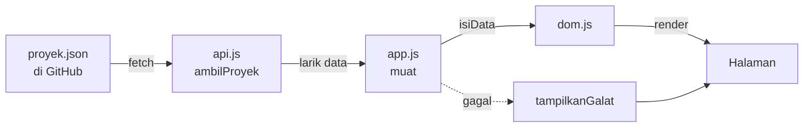

# 🎮 Koleksi Game Steam Saya — Pertemuan 10

### JavaScript Asinkron: `fetch`, Promise, dan JSON

| | |
|---|---|
| **Nama** | Muhammad Naufal Arliansyah |
| **NIM** | 25523240 |
| **Kelas** | D |
| **Mata kuliah** | Pengembangan Aplikasi Berbasis Web (SIF302) |
| **Tanggal** | 15 Oktober 2026 |

---

### 📌 Ringkasan

Di P9 daftar game masih ditulis sebagai array di `js/app.js`. Di pertemuan ini data dipindahkan ke `data/proyek.json`, diambil lewat `fetch` oleh `js/api.js`, lalu digambar ke halaman oleh `js/dom.js`. Halaman kini menangani **empat keadaan antarmuka**: memuat, berhasil, gagal, dan kosong.

### ✨ Fitur

- Data game diambil dari jaringan (alamat raw GitHub), bukan ditulis di kode.
- `respons.ok` diperiksa sebelum badan dibaca, dan bentuk data dipastikan berupa larik.
- Pesan memuat dan pesan galat tampil **di halaman**, bukan hanya di Console.
- Filter genre dibuat dari data dan dilayani satu pendengar di induk (*event delegation*).
- Form tambah game tetap tervalidasi, dan `id` game baru dihitung otomatis dari `id` terbesar.
- Form tidak bisa menambah game selama data belum berhasil dimuat.

### 🗂️ Struktur Folder

```
worksheet-p10/
├── css/
│   ├── base.css
│   ├── komponen.css
│   ├── layout.css
│   ├── responsif.css
│   ├── tema.css
│   └── token.css
├── data/
│   └── proyek.json      ← baru: data game
├── img/
│   ├── hades.webp
│   ├── hollow-knight.webp
│   ├── koleksi-game-1.webp
│   ├── portal-2.webp
│   ├── stardew-valley.webp
│   └── the-witcher-3.webp
├── js/
│   ├── api.js           ← baru: lapisan data (fetch)
│   ├── app.js           ← perakit
│   └── dom.js           ← lapisan tampilan
├── profil.html
└── README.md
```

### 🔄 Alur Data



### 🧩 Pembagian Tugas Berkas

| Berkas | Peran |
|---|---|
| `data/proyek.json` | Data 5 game: `id`, `judul`, `tahun`, `genre`, `gambar`. |
| `js/api.js` | Menyimpan `ALAMAT` di satu tempat dan mengekspor `ambilProyek()`. Memeriksa `respons.ok`, membaca `json()`, dan memastikan hasilnya larik. **Satu-satunya berkas yang memanggil `fetch`.** |
| `js/dom.js` | Seluruh sentuhan ke halaman. Mengekspor `render`, `tampilkanGalat`, `aturMemuat` (kontrak untuk P11) dan `isiData` (dipakai `app.js`). Memakai `textContent`, bukan `innerHTML`. |
| `js/app.js` | Perakit: mengimpor dari `api.js` dan `dom.js`, mengisi judul/deskripsi/footer, lalu menjalankan `muat()` dengan `try/catch/finally`. Tidak memanggil `fetch` sendiri. |
| `profil.html` | Ditambah `<p id="muat" hidden>` dan `<p id="galat-muat" role="alert" hidden>`. Skrip yang dimuat sekarang `js/app.js`. |

### 💻 Kode Kunci

**`js/api.js`: lapisan data**

```js
const ALAMAT =
  'https://raw.githubusercontent.com/NAUFALcreator/Tugas-Pabw-1/refs/heads/main/worksheet-p10/data/proyek.json';

export async function ambilProyek() {
  try {
    const respons = await fetch(ALAMAT);
    if (!respons.ok) throw new Error('status ' + respons.status);

    const data = await respons.json();
    if (!Array.isArray(data)) throw new Error('bentuk data bukan larik');
    return data;
  } catch (galat) {
    console.error('gagal memuat', galat.message);
    throw galat;
  }
}
```

**`js/app.js`: perakit**

```js
async function muat() {
  aturMemuat(true);
  try {
    const daftarGame = await ambilProyek(); // respons.ok sudah diperiksa di api.js
    isiData(daftarGame, buatRingkasan);     // dom.js menyaring lalu memanggil render()
    laporKonsol(daftarGame);
  } catch (galat) {
    tampilkanGalat('Data gagal dimuat. Periksa koneksi, lalu muat ulang halaman.');
    console.error(galat.message);           // untuk pengembang, bukan untuk pengguna
  } finally {
    aturMemuat(false);
  }
}
muat();
```

**`js/dom.js`: `render()` memakai tiga langkah**

```js
export function render(daftar) {
  katalog.textContent = '';          // 1. kosongkan lebih dulu
  pesanGalat.hidden = true;
  if (daftar.length === 0) {         // 2. keadaan kosong
    kosong.hidden = false;
    return;
  }
  kosong.hidden = true;
  daftar.forEach((game, i) => fragmen.append(buatKartu(game, i)));  // 3. isi ulang
}
```

### 🖥️ Empat Keadaan Antarmuka

| Keadaan | Kapan terjadi | Yang tampil |
|---|---|---|
| ⏳ Memuat | Sebelum balasan datang | "Memuat data..."; filter dan katalog disembunyikan |
| ✅ Berhasil | Balasan berisi data | Ringkasan, tombol filter, dan kartu game |
| ❌ Gagal | Jaringan gagal, status bukan 2xx, atau data bukan larik | "Data gagal dimuat. Periksa koneksi, lalu muat ulang halaman." |
| 📭 Kosong | Larik kosong atau genre tanpa game | Pesan keadaan kosong, bukan layar putih |

### 🧱 Tiga Kasus Sulit

| Kasus | Gejala | Penanganan di kode |
|---|---|---|
| Status 404 tidak melempar galat | Kartu kosong, Console bersih | `if (!respons.ok) throw new Error(...)` sebelum `json()` |
| `await` di fungsi biasa | Seluruh skrip berhenti | `ambilProyek()` dan `muat()` dideklarasikan `async` |
| Balasan sah tanpa butir | Halaman tampak kosong | `render()` memeriksa `daftar.length === 0` dan menampilkan pesan |

### 🔁 Perubahan dari P9

| Bagian | P9 | P10 |
|---|---|---|
| Sumber data | Array `daftarGame` di `app.js` | `data/proyek.json` lewat `fetch` |
| Isi `app.js` | Data + fungsi + render | Perakit: memanggil `api.js` dan `dom.js` |
| Elemen halaman | Tanpa keadaan memuat/galat | Ada `#muat` dan `#galat-muat` |
| Form tambah game | Langsung `push` | Ditolak bila data belum siap; `id` baru dihitung dengan `reduce` |
| Log Console | Langsung di level atas | Dibungkus `laporKonsol()` karena data baru ada setelah diambil |

### 🧪 Hasil Pengujian

| Yang diuji | Hasil |
|---|---|
| Panggilan ke alamat data | `respons.ok` = `true`; status dan Content-Type tercatat di Console |
| Alamat sengaja dirusak | Pesan galat tampil di halaman, Console bersih dari galat tak tertangani |
| Jaringan dimatikan di panel Network | Pesan galat tampil, bukan layar kosong |
| `render([])` dari Console | Pesan keadaan kosong tampil |
| Muat ulang halaman | Kartu tidak berlipat |
| Alamat dikembalikan | Daftar tampil lagi tanpa mengubah kode lain |

### 🌐 Sumber Data

Data diambil dari alamat raw GitHub (repositori publik). Saat dikembangkan, `ALAMAT` masih berupa `data/proyek.json` lokal; menggantinya cukup satu baris di `js/api.js`, tanpa mengubah kode lain.

```
https://raw.githubusercontent.com/NAUFALcreator/Tugas-Pabw-1/refs/heads/main/worksheet-p10/data/proyek.json
```

> Isi baru di alamat raw bisa terlambat sekitar lima menit setelah `push` karena cache.

### ▶️ Cara Menjalankan

`fetch` tidak jalan bila halaman dibuka dengan klik dua kali (`file://`). Jalankan lewat server lokal:

- VS Code → klik kanan `profil.html` → **Open with Live Server**, atau
- `python3 -m http.server 8000` lalu buka `http://localhost:8000/profil.html`

### 🤖 Penggunaan AI

Saya memakai AI sebagai teman belajar dan pemeriksa. Bantuannya mencakup:

- menjelaskan konsep (`fetch`, `respons.ok`, `async/await`, `try/catch`, `json()` vs `JSON.stringify`);
- membantu membaca panel Network dan Console;
- memeriksa pekerjaan terhadap daftar periksa F.1 dan menyusun README ini.

**Yang saya kerjakan sendiri:** memindahkan data ke `data/proyek.json`, menulis `js/api.js`, mengubah `app.js` dan `dom.js`, menguji keempat keadaan, mengambil data dari GitHub, dan mengisi worksheet. Saya bertanggung jawab memahami kode ini dan sanggup menjelaskannya.
