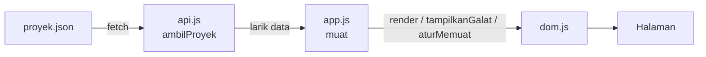

# 🎮 Koleksi Game Steam Saya — Pertemuan 10

### JavaScript Asinkron: `fetch`, Promise, dan JSON

| | |
|---|---|
| **Nama** | Muhammad Naufal Arliansyah |
| **NIM** | 25523240 |
| **Kelas** | D |
| **Mata kuliah** | Pengembangan Aplikasi Berbasis Web (SIF302) |
| **Tanggal** | 15 Oktober 2026 |

---

### 📌 Ringkasan

Di P9 daftar game masih ditulis sebagai array di `js/app.js`. Di pertemuan ini data dipindahkan ke `data/proyek.json`, diambil lewat `fetch` oleh `js/api.js`, lalu digambar ke halaman oleh `js/dom.js`. Halaman kini menangani **empat keadaan antarmuka**: memuat, berhasil, gagal, dan kosong.

### 🗂️ Struktur Folder

```
worksheet-p10/
├── css/
│   ├── base.css
│   ├── komponen.css
│   ├── layout.css
│   ├── responsif.css
│   ├── tema.css
│   └── token.css
├── data/
│   └── proyek.json      ← baru: data game
├── img/                 ← sampul game dari P9
├── js/
│   ├── api.js           ← baru: lapisan data (fetch)
│   ├── app.js           ← perakit
│   └── dom.js           ← lapisan tampilan
├── profil.html
└── README.md
```

### 🔄 Alur Data



### 🧩 Pembagian Tugas Berkas

| Berkas | Peran |
|---|---|
| `data/proyek.json` | Data 5 game: `id`, `judul`, `tahun`, `genre`, `gambar`. |
| `js/api.js` | Menyimpan `ALAMAT` di satu tempat dan mengekspor `ambilProyek()`. Memeriksa `respons.ok` sebelum `json()`. **Satu-satunya berkas yang memanggil `fetch`.** |
| `js/dom.js` | Seluruh sentuhan ke halaman. Mengekspor `render`, `tampilkanGalat`, `aturMemuat`. Memakai `textContent`, bukan `innerHTML`. |
| `js/app.js` | Perakit: mengimpor dari `api.js` dan `dom.js`, lalu menjalankan `muat()` dengan `try/catch/finally`. |
| `profil.html` | Ditambah elemen `<p id="muat" hidden>` untuk keadaan memuat. |

### 💻 Kode Kunci

```js
// js/api.js
const ALAMAT = 'data/proyek.json';

export async function ambilProyek() {
  try {
    const respons = await fetch(ALAMAT);
    if (!respons.ok) throw new Error('status ' + respons.status);
    return await respons.json();
  } catch (galat) {
    console.error('gagal memuat', galat.message);
    throw galat;
  }
}
```

```js
// js/app.js
async function muat() {
  aturMemuat(true);
  try {
    render(await ambilProyek());
  } catch (galat) {
    tampilkanGalat('Data gagal dimuat. Periksa koneksi, lalu muat ulang halaman.');
  } finally {
    aturMemuat(false);
  }
}
muat();
```

### 🖥️ Empat Keadaan Antarmuka

| Keadaan | Kapan terjadi | Yang tampil |
|---|---|---|
| ⏳ Memuat | Sebelum balasan datang | "Memuat data..." |
| ✅ Berhasil | Balasan berisi data | Kartu game dari data |
| ❌ Gagal | Jaringan gagal atau status bukan 2xx | Pesan galat di halaman |
| 📭 Kosong | Balasan sah, larik kosong | "Belum ada data." |

### 🧪 Hasil Pengujian

| Yang diuji | Hasil |
|---|---|
| Panggilan ke `data/proyek.json` | Status 304 (cache), `respons.ok` = `true`, Content-Type `application/json` |
| Alamat sengaja dirusak | Pesan galat tampil di halaman, Console bersih dari galat tak tertangani |
| Jaringan dimatikan di panel Network | Pesan galat tampil, bukan layar kosong |
| `render([])` dari Console | Pesan keadaan kosong tampil |
| Muat ulang halaman | Kartu tidak berlipat |
| Alamat dikembalikan | Daftar tampil lagi tanpa mengubah kode lain |

### 🌐 Data dari GitHub

Setelah semuanya jalan dengan file lokal, `ALAMAT` di `js/api.js` diganti ke alamat raw. Tidak ada kode lain yang berubah.

```
https://raw.githubusercontent.com/NAUFALcreator/Tugas-Pabw-1/main/worksheet-p10/data/proyek.json
```

Panel Network menunjukkan permintaan ke `raw.githubusercontent.com` berstatus 200.

### ▶️ Cara Menjalankan

`fetch` tidak jalan bila halaman dibuka dengan klik dua kali (`file://`). Jalankan lewat server lokal:

- VS Code → klik kanan `profil.html` → **Open with Live Server**, atau
- `python3 -m http.server 8000` lalu buka `http://localhost:8000/profil.html`

### 🤖 Penggunaan AI

Saya memakai AI sebagai teman belajar dan pemeriksa. Bantuannya mencakup:

- menjelaskan konsep (`fetch`, `respons.ok`, `async/await`, `try/catch`, `json()` vs `JSON.stringify`);
- membantu membaca panel Network dan Console;
- memeriksa pekerjaan terhadap daftar periksa F.1 dan menyusun README ini.
- membantu pemeriksaan yang error mana dan cara pengecekan error dll di worksheet

**Yang saya kerjakan sendiri:** memindahkan data ke `data/proyek.json`, menulis `js/api.js`, mengubah `app.js` dan `dom.js`, menguji keempat keadaan, mengambil data dari GitHub, dan mengisi worksheet. Saya bertanggung jawab memahami kode ini dan sanggup menjelaskannya.