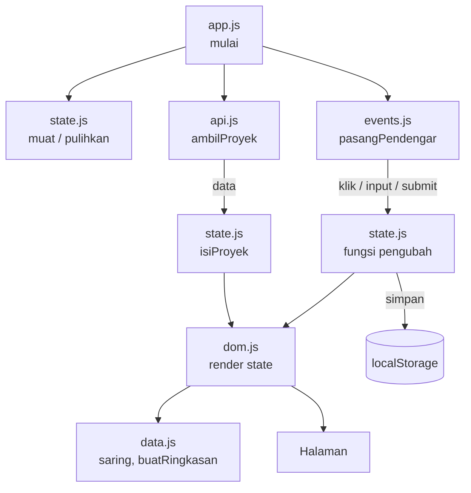

# 🎮 Koleksi Game Steam Saya — Pertemuan 11

### Modul, State, dan Penyimpanan Klien

| | |
|---|---|
| **Nama** | Muhammad Naufal Arliansyah |
| **NIM** | 25523240 |
| **Kelas** | D |
| **Mata kuliah** | Pengembangan Aplikasi Berbasis Web (SIF302) |
| **Tanggal** | 19 Oktober 2026 |

---

### 📌 Ringkasan

Di P10 kode JavaScript terbagi menjadi `app.js`, `dom.js`, dan `api.js`. Di pertemuan ini berkasnya dipecah lagi menjadi **lima modul** (`data.js`, `state.js`, `dom.js`, `events.js`, `app.js`) ditambah `api.js` dari P10, sehingga setiap berkas hanya punya satu tanggung jawab. Seluruh keadaan aplikasi dikumpulkan di satu objek `state`, tampilan digambar ulang dari state lewat `render(state)`, dan pilihan pengguna (kategori aktif dan daftar favorit) disimpan di `localStorage` sehingga halaman mengingatnya setelah dimuat ulang.

Satu-satunya fitur baru adalah tombol ☆/★ favorit di setiap kartu dan tombol **Atur ulang**.

### 🗂️ Struktur Folder

```
worksheet-p11/
├── css/
│   ├── base.css
│   ├── komponen.css
│   ├── layout.css
│   ├── responsif.css
│   ├── tema.css
│   └── token.css
├── img/                 ← sampul game dari P9
├── js/
│   ├── api.js           ← dari P10: lapisan data (fetch), dipakai apa adanya
│   ├── app.js           ← perakit
│   ├── data.js          ← baru: profil, aturan validasi, fungsi murni
│   ├── dom.js           ← lapisan tampilan
│   ├── events.js        ← baru: seluruh pendengar peristiwa
│   └── state.js         ← baru: objek state, fungsi pengubah, penyimpanan
├── profil.html
└── README.md
```

### 🔄 Alur Modul



Arah impor: `app.js` → semua modul, `events.js` → `dom.js` dan `state.js`, `state.js` → `dom.js`, `dom.js` → `data.js`. Tidak ada impor melingkar.

### 🧩 Pembagian Tugas Berkas

| Berkas | Tanggung jawab |
|---|---|
| `js/data.js` | Objek `profil`, `genreTetap`, aturan validasi form, dan fungsi murni (`cekGameBaru`, `buatBarisFooter`, `formatGenre`, `buatRingkasan`, `rapikanGenre`, `rapikanItem`, `saring`). Tidak menyentuh halaman dan tidak tahu state. |
| `js/state.js` | Objek `state` tunggal dan fungsi pengubah (`isiProyek`, `pilihKategori`, `tambahFavorit`, `tambahGame`, `aturGagalKirim`, `aturUlang`), serta penyimpanan (`simpan`, `muat`, `pulihkan`). Setiap pengubah memanggil `render(state)`. |
| `js/dom.js` | Seluruh sentuhan ke halaman: pemilih `el`, `render(state)`, `buatKartu`, tombol filter, validasi form. Memakai `textContent`, bukan `innerHTML`. |
| `js/events.js` | Memasang semua pendengar lewat `pasangPendengar()`: klik filter, klik favorit, tombol atur ulang, input dan submit form. Hanya memanggil fungsi pengubah. |
| `js/app.js` | Perakit: mengimpor semuanya dan menjalankan `mulai()`. Tidak berisi logika. |
| `js/api.js` | Dari P10, tidak diubah. Satu-satunya berkas yang memanggil `fetch`. |

### 🧠 State Tunggal

```js
export const state = {
  daftarProyek: [],
  kategoriAktif: "semua",
  favorit: [],
  siap: false,
  gagalKirim: false,
};
```

Tidak ada keadaan yang dibaca dari DOM. Tombol filter aktif dan bintang favorit digambar dari `state.kategoriAktif` dan `state.favorit`.

### 💻 Kode Kunci

```js
// js/state.js: setiap perubahan lewat satu fungsi bernama
export function tambahFavorit(id) {
  if (state.favorit.includes(id)) return;
  state.favorit = [...state.favorit, id];   // salinan baru, bukan push
  simpan(state);
  render(state);
}
```

```js
// js/state.js: muat() menangani simpanan rusak dan versi lama
export function muat() {
  try {
    const isi = JSON.parse(localStorage.getItem(KUNCI));
    if (isi?.versi !== VERSI) {
      localStorage.removeItem(KUNCI);
      return null;
    }
    return isi;
  } catch {
    localStorage.removeItem(KUNCI);
    return null;
  }
}
```

```js
// js/app.js: perakit
async function mulai() {
  isiProfil(profil);
  pulihkan(muat());      // pulihkan pilihan terakhir sebelum render pertama
  pasangPendengar();
  aturMemuat(true);
  try {
    isiProyek((await ambilProyek()).map(rapikanItem));
  } catch (galat) {
    tampilkanGalat("Data gagal dimuat. Periksa koneksi, lalu muat ulang.");
  } finally {
    aturMemuat(false);
  }
}
mulai();
```

### 💾 Penyimpanan

Kunci `pabw-p11` berisi teks JSON `{ versi, kategoriAktif, favorit }` dan disimpan setiap kali keadaan berubah.

| Keadaan | Disimpan? | Alasan |
|---|---|---|
| Kategori aktif | Ya | Pilihan tampilan kecil dan berguna diingat |
| Daftar favorit | Ya | Pilihan pengguna berupa array id, kecil dan jauh dari batas 5 MB |
| Data proyek dari server | Tidak | Selalu diambil ulang lewat `ambilProyek()`; salinan lama bisa usang |
| Token, kata sandi, data pribadi | Tidak | `localStorage` tidak terenkripsi dan bisa dibaca siapa pun di komputer itu |

Nilai bawaan pada kunjungan pertama: `kategoriAktif = "semua"` dan `favorit = []`. Tombol **Atur ulang** menghapus simpanan dan mengembalikan nilai bawaan.

### 🧪 Hasil Pengujian

| Yang diuji | Hasil |
|---|---|
| Halaman setelah dipecah menjadi lima modul | Berjalan sama seperti P10, Console bersih, tidak ada galat impor |
| Ganti kategori | Hanya `state.kategoriAktif` yang berubah, kartu dan tombol aktif ikut dari state |
| Klik kategori yang sama dua kali | Tampilan tidak berubah maupun berlipat |
| Tandai favorit, tutup tab, buka lagi | Pilihan terakhir tetap ada |
| Tombol **Atur ulang** | Filter kembali ke "Semua", favorit kosong, simpanan dihapus |
| `localStorage.setItem("pabw-p11", "bukan-json")` lalu muat ulang | Halaman tetap terbuka, simpanan dibuang, nilai bawaan dipakai |
| `localStorage.setItem("pabw-p11", "{}")` lalu muat ulang | Versi tidak cocok, simpanan dibuang, nilai bawaan dipakai |
| `localStorage.getItem("pabw-p11")` setelah muat ulang | `null`, skrip tidak berhenti |

### ▶️ Cara Menjalankan

Modul ES (`type="module"`) dan `fetch` tidak jalan bila halaman dibuka dengan klik dua kali (`file://`). Jalankan lewat server lokal:

- VS Code → klik kanan `profil.html` → **Open with Live Server**, atau
- `python3 -m http.server 8000` lalu buka `http://localhost:8000/profil.html`

Catatan: simpanan terikat alamat, jadi bila nomor port server lokal berubah, pilihan yang tersimpan tidak terlihat.

### 🤖 Penggunaan AI

Saya memakai AI sebagai teman belajar dan pemeriksa. Bantuannya mencakup:

- menjelaskan konsep (`export`/`import`, state tunggal, `localStorage`, `JSON.stringify`/`JSON.parse`, versi skema);
- memeriksa kode terhadap daftar periksa F.1 dan menemukan dua kekurangan: `pulihkan(muat())` belum dipanggil di `app.js`, dan tombol atur ulang belum tersambung ke `events.js`;
- menuliskan perbaikan untuk `profil.html`, `dom.js`, `events.js`, dan `app.js`, serta membantu menyusun README ini.

**Yang saya kerjakan sendiri:** memecah kode P10 menjadi lima modul, memindahkan keadaan ke objek `state`, menulis fungsi penyimpanan, menguji ketiga kasus simpanan rusak dari Console, dan mengisi worksheet. Saya bertanggung jawab memahami kode ini dan sanggup menjelaskannya.