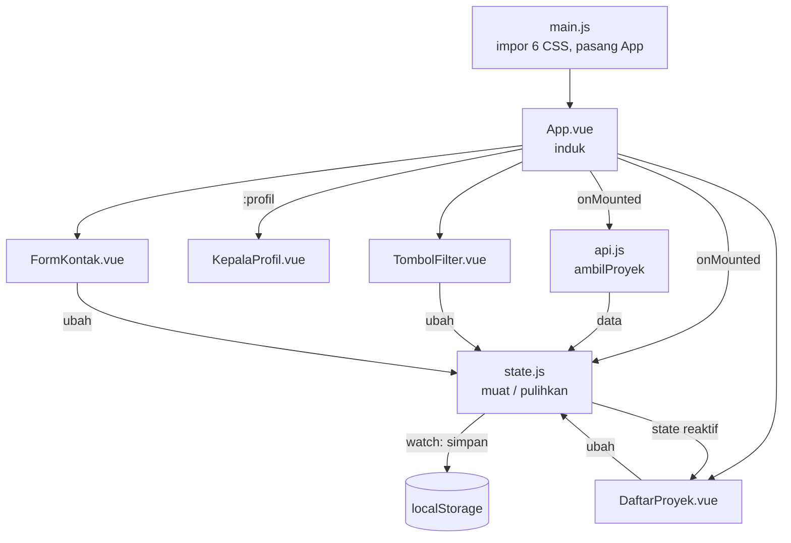

# 🎮 Koleksi Game Steam Saya — Pertemuan 12

### Build Tooling, npm, dan Framework SPA

| | |
|---|---|
| **Nama** | Muhammad Naufal Arliansyah |
| **NIM** | 25523240 |
| **Kelas** | D |
| **Mata kuliah** | Pengembangan Aplikasi Berbasis Web (SIF302) |
| **Tanggal** | 22 Oktober 2026 |

---

### 📌 Ringkasan

Di P11 halaman ini berupa `profil.html` dengan lima modul JavaScript biasa. Di pertemuan ini halaman yang sama dipindahkan ke proyek **Vue 3 + Vite** yang dibuat di folder baru `worksheet-p12/`. Proyek dijalankan dengan `npm run dev`, dipecah menjadi **empat komponen**, lalu dibangun untuk produksi dengan `npm run build` dan dicoba lewat `npm run preview`.

Tidak ada fitur baru dan tidak ada perubahan desain. Token, CSS, dan HTML dari P03–P06 dipakai apa adanya; yang berubah hanya cara halaman digambar: `render(state)` buatan sendiri diganti `reactive()` dan `<template>` milik Vue.

### 🛠️ Perkakas

| Perkakas | Versi |
|---|---|
| Node.js (LTS) | v22.18.0 |
| npm | 10.9.3 |

Perintah yang dipakai untuk membuat proyek (dijalankan di folder kosong; titik berarti "buat di folder ini"):

```bash
cd ~/pabw
mkdir worksheet-p12
cd worksheet-p12
npm create vite@latest . -- --template vue
npm install
npm run dev
```

### 🗂️ Struktur Folder

```
worksheet-p12/
├── public/
│   ├── data/
│   │   └── proyek.json          ← dari P10, dibaca lewat alamat /data/proyek.json
│   └── img/                     ← sampul game, dipanggil lewat /img/...
├── src/
│   ├── components/
│   │   ├── KepalaProfil.vue
│   │   ├── TombolFilter.vue
│   │   ├── DaftarProyek.vue
│   │   └── FormKontak.vue
│   ├── api.js                   ← dari P10, dipindah
│   ├── data.js                  ← profil dan fungsi murni, isinya tetap
│   ├── state.js                 ← state reaktif, fungsi pengubah, penyimpanan
│   ├── token.css                ← enam berkas CSS P04–P06, isinya tidak diubah
│   ├── base.css
│   ├── layout.css
│   ├── komponen.css
│   ├── tema.css
│   ├── responsif.css
│   ├── App.vue                  ← komponen induk
│   └── main.js                  ← titik masuk, mengimpor CSS
├── index.html
├── package.json
├── package-lock.json
├── vite.config.js
├── .gitignore
└── README.md
```

### 🔄 Alur Berkas



### 🧩 Empat Komponen

| Komponen | Bagian halaman | Data yang dipakai |
|---|---|---|
| `KepalaProfil.vue` | Identitas di atas halaman | props `profil` dari `App.vue` |
| `TombolFilter.vue` | Tombol kategori dan tombol atur ulang | state bersama |
| `DaftarProyek.vue` | Kartu game, tombol ☆/★, pesan memuat / kosong / gagal | state bersama |
| `FormKontak.vue` | Formulir | state bersama |

Hanya `KepalaProfil` yang menerima props, supaya tidak ada dua mekanisme data yang harus dipahami sekaligus. Komponen anak hanya **membaca** props dan tidak pernah mengubahnya.

### 🔁 Dari P11 ke P12

| Di P11 | Di P12 (Vue) |
|---|---|
| `const state = { ... }` | `const state = reactive({ ... })` |
| Fungsi pengubah memanggil `render(state)` | `render(state)` dihapus; cukup ubah state, Vue menggambar ulang |
| `dataProyek.map(...)` lalu ditempel | `v-for="proyek in ..."` dengan `:key` berisi id |
| `textContent = nilai` | `{{ nilai }}` |
| `addEventListener("click", ...)` | `@click="..."` |
| Pesan memuat / kosong / gagal lewat fungsi DOM | `v-if` / `v-else-if` di `DaftarProyek.vue` |
| `pulihkan(muat())` di `mulai()` | `onMounted` di `App.vue` |
| `simpan(state)` dipanggil di tiap pengubah | `watch(state, ..., { deep: true })` |

### 💻 Kode Kunci

```js
// src/state.js
import { reactive } from 'vue'

export const state = reactive({
  kategoriAktif: 'semua',
  daftarProyek: [],
  favorit: [],
  memuat: true,
  galat: '',
})

export function pilihKategori(nilai) {
  state.kategoriAktif = nilai      // tanpa render()
}
```

```js
// src/App.vue (<script setup>)
onMounted(async () => {
  pulihkan(muat())                   // pilihan terakhir dari localStorage
  try {
    isiProyek(await ambilProyek())
  } catch (galat) {
    state.galat = 'Data gagal dimuat. Periksa koneksi, lalu muat ulang.'
  } finally {
    state.memuat = false
  }
})

watch(state, (nilai) => simpan(nilai), { deep: true })
```

```js
// src/main.js: satu-satunya tempat CSS diimpor
import { createApp } from 'vue'
import App from './App.vue'

import './token.css'
import './base.css'
import './layout.css'
import './komponen.css'
import './tema.css'
import './responsif.css'

createApp(App).mount('#app')
```

### 📦 Hasil Build

Diukur di DevTools → tab **Network**, **Disable cache** dicentang, muat ulang dengan Ctrl+Shift+R. "Sebelum" dari `npm run dev`, "sesudah" dari `npm run preview`.

| Yang diukur | Sebelum build | Sesudah build |
|---|---|---|
| Ukuran seluruh berkas yang dikirim | 12.2 MB | 10.6 MB |
| Jumlah berkas yang dikirim peramban | 30 | 10 |

Yang saya amati:

- **Jumlah berkas turun jauh (30 menjadi 10).** Vite menggabungkan Vue, `App.vue`, empat komponen, `data.js`, `state.js`, `api.js`, dan enam CSS menjadi satu `index-xxxx.js` dan satu `index-xxxx.css`.
- **Ukuran kode turun jauh.** Di mode dev `vue.js` saja 1.2 MB; sesudah build seluruh JavaScript hanya sekitar 29 kB.
- **Ukuran total turun tidak banyak** karena sebagian besar isinya gambar game di `public/` (misalnya `hades.webp` 4.5 MB dan `portal-2.webp` 3.0 MB) yang dikirim apa adanya. Build tidak memperkecil gambar.
- Nama berkas di `dist/assets/` memuat huruf dan angka acak (hash), sehingga peramban tidak memakai salinan lama saat isinya berubah.

Perintah yang dipakai:

| Perintah | Kapan |
|---|---|
| `npm run dev` | Selama mengerjakan |
| `npm run build` | Menghasilkan folder `dist/` setelah pekerjaan selesai |
| `npm run preview` | Menjalankan isi `dist/` untuk memastikan hasil build benar |

### 🚫 Yang Tidak Di-commit

| Berkas | Alasan |
|---|---|
| `dist/` | Hasil build, dibuat ulang kapan saja dengan `npm run build` |
| `node_modules/` | Ribuan berkas, bisa dipasang ulang dengan `npm install` |
| `.env`, `.DS_Store` | Berkas lokal |

`package.json` dan `package-lock.json` **sengaja di-commit**. Lockfile mengunci versi tepat semua paket sehingga `npm install` di komputer lain menghasilkan hasil yang sama.

### 🧪 Hasil Pengujian

| Yang diuji | Hasil |
|---|---|
| `npm run dev` membuka halaman | Halaman Koleksi Game Steam tampil |
| Tampilan dibanding P11 | Sama: warna, huruf, dan jarak |
| Ganti kategori | Hanya state yang berubah, tampilan ikut sendiri |
| Tutup tab, lalu buka lagi | [isi sesuai hasil ujimu] |
| `localStorage.setItem("pabw-p11", "bukan-json")` lalu muat ulang | [isi sesuai hasil ujimu] |
| `localStorage.clear()` lalu muat ulang | [isi sesuai hasil ujimu] |
| `npm run build` | `dist/` terbentuk, berisi `index.html` dan `assets/` |
| `npm run preview` | Halaman jalan dari `dist/` |
| Console | [bersih / tulis temuanmu] |

### ⚠️ Masalah yang Sempat Terjadi

- **Halaman putih di `localhost:5173`.** Ternyata port itu dipakai proyek React lama yang servernya masih jalan, sehingga alamat yang saya buka bukan proyek ini. Penyelesaiannya: membuka alamat persis seperti yang tertulis di terminal `worksheet-p12/` dan menghentikan server proyek lain. Hal yang sama terjadi pada `npm run preview`.
- **`favicon.ico` 404 di Console.** Peramban otomatis meminta ikon yang tidak ada. Diperbaiki dengan menambahkan `<link rel="icon" href="data:," />` di `index.html`.
- **Nama berkas berbeda huruf besar-kecil** (`Kepalaprofil.vue` vs `KepalaProfil.vue`) berjalan di Windows tetapi gagal di Linux atau CI, jadi nama berkas dan nama impor disamakan persis.

Catatan: simpanan `localStorage` terikat alamat beserta port-nya, jadi bila port berubah, pilihan yang tersimpan tidak terlihat.

### ▶️ Cara Menjalankan

```bash
git clone [alamat repositori]
cd worksheet-p12
npm install
npm run dev        # mengerjakan
npm run build      # membuat dist/
npm run preview    # mencoba hasil build
```

Gunakan Node.js LTS (saya memakai v22.18.0). Bila build gagal di komputer lain, samakan versi Node.js terlebih dahulu.

### 🤖 Penggunaan AI

Saya memakai AI sebagai teman belajar dan pemeriksa. Bantuannya mencakup:

- menjelaskan cara mengukur ukuran dan jumlah berkas di DevTools (tabel sebelum dan sesudah build);
- menemukan penyebab halaman putih (port 5173 dipakai proyek React lama) dan penyebab error `favicon.ico` 404;
- menyusun draf jawaban tiket keluar, keterangan di tabel rujukan, dan README ini.

**Yang saya kerjakan sendiri:** membuat proyek di folder kosong, memindahkan aset P11, memecah empat komponen, menyambungkan state dan localStorage, menjalankan build dan preview, mengisi worksheet. Saya bertanggung jawab memahami kode ini dan sanggup menjelaskannya.